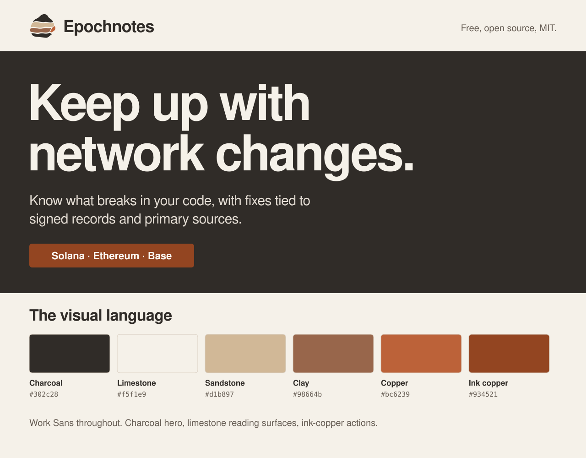

# Epochnotes visual identity

A field journal for network changes. Geological strata represent epochs: each layer preserves a record, and the copper seam marks a point of change.

## Palette

| Token      | Color     | Role                                     |
| ---------- | --------- | ---------------------------------------- |
| Charcoal   | `#302c28` | Text, mark, primary action               |
| Limestone  | `#f5f1e9` | Page and artwork background              |
| Sandstone  | `#d1b897` | Historical layers and structural accents |
| Clay       | `#98664b` | Secondary layers                         |
| Copper     | `#bc6239` | The change seam, decorative emphasis     |
| Ink copper | `#934521` | Accessible links on limestone            |

Dark pages use warm charcoal `#211f1c`, pale text `#f0e9df` and light copper `#eda579` for links. The mark's charcoal strata become mineral gray `#a89c8d` to retain their silhouette. State colors remain semantic and always appear with a text label.

## Typography

The homepage uses Work Sans for headings, its wordmark and body text. The variable Latin font is bundled in `assets/fonts/work-sans-latin.woff2` under the SIL Open Font License in `assets/fonts/OFL.txt`; the page makes no font request to another host. Monospace is reserved for commands and code. The existing README cover and social artwork retain their editorial Georgia typography.

Large headlines use short lines, tight spacing and bold weight. Body text uses a 1.6 line height and a maximum reading width of 72 characters. Labels use sentence case and ordinary spacing.

## Mark and composition

Use `mark.svg` as the source mark. Keep one quarter of its width clear around it. Use it at 32 px or larger; for smaller favicons retain the silhouette and omit interior hairlines. Preserve the strata's proportions, irregular boundaries and copper exposure. Do not stretch, rotate, add shadows or enclose it in a shield.

The homepage pairs a charcoal hero with limestone reading surfaces and ink-copper actions. Its product example layers source, signed record and code impact as sandstone sheets with simple chevrons; text stays level. On phones the sheets become a vertical reading sequence. Use flat surfaces, open text groups and native disclosures for detailed records. Keep command output readable and date every snapshot.

## Assets and publishing

- `mark.svg`: scalable standalone mark.
- `icon.png`: transparent 180 × 180 icon.
- `project-logo.png`: 1024 × 1024 logo on white for project submission forms and dark host pages; editable source in `project-logo.svg`.
- `github-banner.svg`: README cover, 1280 × 640.
- `social.png`: 1280 × 640 social preview; upload it in GitHub repository Settings → General → Social preview.
- `social.svg`: editable source for the social preview.
- `style-board.svg`: palette and composition reference.

The page loads the original `mark.svg` locally, embeds its SVG favicon, and uses the bundled Work Sans font. It has no scripts or resources hosted elsewhere. Regenerate SVGs with `npm run brand`; regenerate the page with `npm run site`. After changing the artwork, export `social.svg` to a 1280 × 640 PNG and `mark.svg` to a transparent 180 × 180 PNG. GitHub repository controls use GitHub's own theme; the identity applies to the README and repository social preview.
